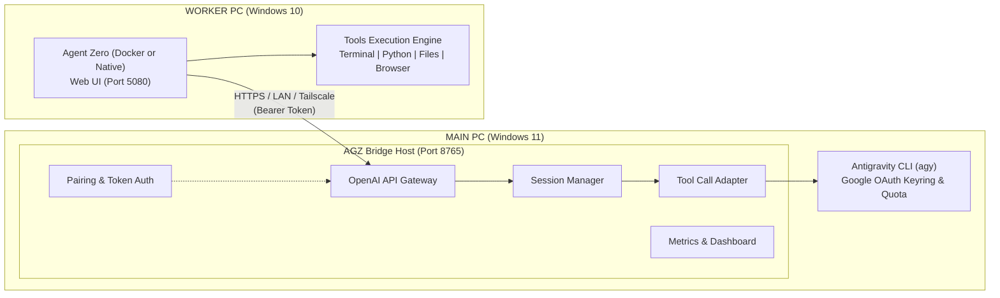

# AGZ BRIDGE: Antigravity CLI &rarr; Agent Zero Autonomous Bridge

[](https://github.com/V1nter111/AGZ-BRIDGE/releases)
[](LICENSE)
[](https://microsoft.com)
[-4285F4.svg)](https://antigravity.google)
[](https://github.com/agent0ai/agent-zero)

**AGZ Bridge** connects **Google Antigravity 2.0 CLI (`agy`)** on your primary machine to **Agent Zero** on a secondary computer, enabling you to use your Google account subscription quotas and models (such as `Gemini 3.8 Flash (High)`) as a remote intelligence backend while executing all tools, terminal commands, browser actions, and computer use **strictly on the secondary machine**.

---

## 🏛 Architecture



### Turn Lifecycle
1. User submits a task to Agent Zero on the **WORKER PC**.
2. Agent Zero forwards the request to **AGZ Bridge Host** via `/v1/chat/completions`.
3. The Host translates the messages and invokes **Antigravity CLI** in an isolated context on **MAIN PC**.
4. The Gemini model produces reasoning and structured tool calls (e.g. `write_file`, `execute_command`).
5. AGZ Bridge verifies that tools are **not** executed on MAIN PC and formats the structured tool call for Agent Zero.
6. Agent Zero physically executes the tool on the **WORKER PC**.
7. The execution result is returned to the Host.
8. The conversation continues until the task is complete.

---

## 🚀 One-Command Deployment for Second Computer

After starting the Host on your Main PC, go to your **Second Computer (Windows 10)**, open PowerShell, and run:

```powershell
& ([scriptblock]::Create((irm "https://raw.githubusercontent.com/V1nter111/AGZ-BRIDGE/v1.0.0/scripts/install-worker.ps1"))) -HostUrl "http://<MAIN_PC_IP>:8765" -PairingCode "<ONE_TIME_CODE>"
```

The installer will automatically:
1. Verify Windows version, architecture, and free disk space.
2. Pair securely with MAIN PC using the single-use pairing code.
3. Obtain a scoped Worker API token.
4. Install and configure **Agent Zero** (using Docker or native Python mode).
5. Set `gemini-3.8-flash-high` as the primary default model in `presets.yaml`.
6. Configure auto-start on Windows boot.
7. Run an end-to-end self-test to verify connectivity.
8. Provide the local Web UI link (`http://localhost:5080`).

---

## 💻 MAIN PC Setup & Operations

### 1. Installation
Run the host installer on MAIN PC:
```powershell
.\scripts\Install-Host.ps1
```
This verifies Python, Antigravity CLI (`agy`), existing Google account subscription login, and creates the Windows Startup shortcut.

### 2. Service Management
| Action | Script | Description |
|---|---|---|
| **Start Host** | `.\scripts\Start-Host.ps1` | Launches Host in background, displays active pairing code and LAN URL |
| **Stop Host** | `.\scripts\Stop-Host.ps1` | Gracefully stops Host and frees port 8765 |
| **Restart Host** | `.\scripts\Restart-Host.ps1` | Restarts server and refreshes endpoints |
| **Status & Code** | `.\scripts\Get-HostStatus.ps1` | Displays live status, token usage, connected workers, and fresh pairing code |
| **Update Host** | `.\scripts\Update-Host.ps1` | Pulls latest updates from Git and reloads |

### 3. Interactive Web Dashboard
Open `http://localhost:8765/dashboard` in your browser on MAIN PC to view:
- Real-time connection status and uptime.
- Active single-use pairing code with copy button and countdown timer.
- Ready-to-copy PowerShell installation command.
- Connected worker devices with IP, last-seen timestamp, and instant Revoke button.
- Live token usage and request activity history.

---

## 🔒 Security & Privacy

- **No Public Port Exposure**: Designed to operate strictly over LAN or Tailscale private meshes.
- **CIDR Network Filtering**: Rejects connections originating outside private networks (RFC 1918 + Tailscale CGNAT).
- **One-Time Pairing Codes**: Codes are single-use, cryptographically generated, and expire after 15 minutes.
- **Hashed Worker Tokens**: Host stores only SHA-256 hashes of worker tokens; secrets are never stored in plain text.
- **Strict Host Isolation**: Antigravity CLI runs without `--dangerously-skip-permissions`. If the model ever requests local host execution, it is rejected by default. All commands execute exclusively on the Worker PC.
- **Secret Scrubbing**: Automatic regex scrubbing ensures tokens and credentials are never leaked into logs.

---

## 🧪 Automated Test Suite

The project includes an end-to-end test suite (`tests/`):

| Test Suite | Description | Status |
|---|---|:---:|
| **TEST A** | Antigravity CLI discovery, Google OAuth keyring check, turn execution, context continuation | **PASS** |
| **TEST B** | API Gateway: `/v1/models`, `/v1/chat/completions` (JSON & SSE streaming), concurrency | **PASS** |
| **TEST C** | Tool calling adapter, structured JSON extraction, argument translation, worker isolation | **PASS** |
| **TEST D** | Agent Zero `presets.yaml` format and provider configuration compatibility | **PASS** |
| **TEST E** | Security: single-use pairing code, expiration, invalid codes, token revocation, log redaction | **PASS** |
| **TEST F** | PowerShell scripts syntax validation (AST parsing), parameter checking | **PASS** |
| **TEST G** | **E2E Physical Tool Cycle**: file creation on worker disk, verification, model continuation | **PASS** |

Run tests anytime:
```powershell
python -m pytest tests -v
```

---

## 📄 License
MIT License. See [LICENSE](LICENSE) for details.
